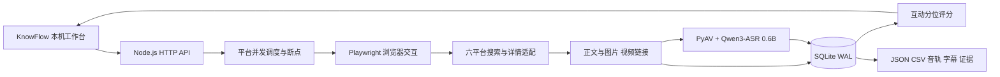

# 知流 · KnowFlow

**连接多平台内容、知识检索与自媒体创作。**

KnowFlow 当前提供可在本机运行的内容采集工作台：输入一个检索词，选择抖音、小红书、今日头条、知乎、CSDN、B站，按相同目标量采集完整主体内容，保留图文资源、视频转写、互动数据和执行证据。

本仓库已整合选题发现、六平台内容采集、本地向量检索与章节辅助创作。使用说明见[选题与创作工作流](docs/CREATION.md)；自动发布仍在[后续规划](docs/ROADMAP.md)中。

## 当前功能

- 抖音／小红书联想词递归采集、关键词地图、断点、旧记录导入，以及选题带入统一采集。
- 自动选择影响力靠前且有明确章节的参考文章，DeepSeek Flash 语义拆段，当前任务内其他完整文章的本地 BGE 向量召回，带来源引用的章节草稿、编辑与导出。
- 创作分阶段保存断点；密钥使用 Windows DPAPI 按当前用户加密，不进入仓库。


- 六平台搜索与详情适配、平台选择、每平台完整内容目标。
- 普通浏览器输入、点击、滚动、关闭详情；有界随机间隔与页面加载检查分别执行。
- 平台窗口并发，同平台逐条处理；视频转写默认单并发。
- 标题、作者、时间、正文、平台原文、图片URL、视频媒体URL与互动指标。
- 视频统一使用本地 PyAV + Qwen3-ASR 0.6B 提取音轨和转写；平台字幕只作补充证据。分段时间范围不冒充逐字对齐。
- SQLite增量保存、断点、日志、截图、JSON／CSV导出。
- 人工登录／验证页保留、页面变化监测、确认恢复后续采；安全停止会停止自动恢复。
- 知乎使用已登录列表上下文和独立未登录详情上下文，以实际主搜索卡片链接队列连接，不传递登录资料。
- 六平台及全部内容类型共用参照池，按互动分位和固定权重计算跨平台互动指数，显示统一排名、指标覆盖率和试算标识。

这是一套本机运行版本：单服务、单活动检索任务，任务内部支持多平台并发。多机分布式、Redis调度不属于当前功能。登录与平台访问保护会影响实测结果，不能把适配器存在等同于所有内容始终可访问。

## 快速开始（Windows）

准备 Node.js **22.13或更新版本**、Microsoft Edge，以及用于知乎详情的Google Chrome。视频音频转写另需Python环境和本地 [Qwen3-ASR 0.6B 模型](https://huggingface.co/Qwen/Qwen3-ASR-0.6B)。

```powershell
git clone https://github.com/TMENG888/KnowFlow.git E:\Codex\work\knowflow\KnowFlow
Set-Location E:\Codex\work\knowflow\KnowFlow
npm ci --cache E:\Codex\temp\knowflow\npm-cache
npm start
```

访问 **http://127.0.0.1:54280/**。也可以双击 `启动平台.cmd` 或执行 `Start-Platform.ps1`。默认仅监听本机，拒绝外站写入请求。

1. 输入检索词、勾选平台、设置每平台目标量。
2. 按需打开视频转写。未配置本地模型时，可先测试图文；视频仅有标题不会计入完整内容目标。
3. 点击开始采集。在平台自己的窗口中按正常流程完成登录或验证。
4. 查看内容、媒体链接、转写与证据，通过JSON／CSV导出。
5. 使用安全停止结束本任务及其自动恢复。关闭工作台标签页不会停止后台任务。

## 配置与私有数据

公共默认配置为 `settings.json`。复制需要覆盖的**顶层字段**到 `settings.local.json` 即可；本地文件已被Git忽略。对象字段如 `pacing` 和 `scoreWeights` 整体覆盖，不做深度合并。

```json
{
  "port": 54280,
  "outputDir": "E:/Codex/outputs/knowflow",
  "tempDir": "E:/Codex/temp/knowflow",
  "pythonExecutable": "E:/Codex/work/knowflow/.venv/Scripts/python.exe",
  "asrModel": "E:/Codex/work/knowflow/models/Qwen3-ASR-0.6B"
}
```

默认输出、媒体、缓存、模型和浏览器资料均位于E盘。没有E盘的机器须先将配置路径改为可用磁盘；相对路径以仓库根目录解析。SQLite位于仓库下的 `data/`，不会提交到Git。

浏览器资料是Chrome／Edge自己维护的用户资料文件夹，包含Cookie和站点存储，不是单一配置文件。初次运行必须在本机建立自己的资料；本仓库不包含原机器的登录会话，也不保证新建空资料能直接读取所有平台。

| 配置 | 用途 |
| --- | --- |
| `profileDir` | 通用采集浏览器专用资料 |
| `zhihuListProfileDir` | 知乎列表浏览器资料，允许人工登录 |
| `zhihuDetailProfileDir` | 知乎独立详情资料，保持未登录 |
| `zhihuDetailExecutablePath` | 独立详情浏览器exe，留空沿用默认浏览器 |
| `browserCdpEndpoint` | 可选的本机专用浏览器CDP地址；默认空，不连接其他项目浏览器 |
| `platformConcurrency` | 平台并发数，默认6 |
| `mediaConcurrency` | 本地转写并发数，默认1 |

知乎正文已经加载时，程序可以点击网站原有关闭按钮关闭可选登录弹窗。正文缺失、40362、付费截断和安全验证仍会暂停并保留证据。此前的实机对照表明调试状态不是40362的必然原因，尚未证明某个Cookie或启动参数是唯一触发因素；程序不会靠伪造签名或复制日常浏览器Cookie获取正文。

## 视频转写

在可用Python环境中安装：

```powershell
python -m pip install -r requirements-asr.txt --cache-dir E:\Codex\temp\knowflow\pip-cache
```

将完整的 `Qwen/Qwen3-ASR-0.6B` 官方 Transformers 模型放到 `asrModel` 指定目录，配置 `pythonExecutable` 指向安装了 requirements-asr.txt 的独立Python 3.10+环境；建议3.11。采集推理离线加载本地权重，不自动回退到其他模型。旧 `pythonSite` 不再注入ASR环境。

`asrBackend` 固定 `qwen3-asr-0.6b`；`asrDevice=auto` 在CUDA可用时使用GPU FP16，否则CPU FP32；本机当前为CPU。RTX 4050机器需要先安装与驱动兼容的CUDA版PyTorch，不能仅靠修改配置获得GPU支持。`asrThreads=8`，`asrChunkSeconds=25`，`asrLanguage=Chinese`，转写并发默认1。每段保存 `.transcript.progress.json`，重试时校验音轨指纹、模型与参数，仅复用匹配断点。

Qwen未配置强制对齐模型，本版时间戳为音频分段起止范围（`timestampType=audio_chunk`），不提供逐字时间戳或虚构置信度。基础检查通过仅代表本次音频处理完成，不代表文字无误。新视频全部走Qwen；已有历史字幕保留原模型来源，不自动重写。

默认限制单媒体150MB、单视频30分钟。超限、下载失败或需复核的转写保留缺口，不截断冒充完整正文。媒体链接可能过期，导出保留观察时间和原文地址。

## B站关键词采集

选择“B站”后，从可见搜索框提交统一关键词，逐条点击真实视频卡片。只处理被点击视频／当前P，使用 BV号与当前P核验来源；不调用旧课程脚本的合集遍历。当前视频的标题、简介、作者、日期、封面、视频与音轨链接、互动数据来自页面自身元数据及播放响应，不额外构造签名请求。

优先下载当前视频的完整音轨交由Qwen0.6B；音轨链接与视频链接分开保留。多段durl不会只取第一段冒充全视频。缺音轨、预览、付费、登录或验证保护仍保留缺口。投币、弹幕位于 `metricsExtra`，不冒充点赞、分享或加入原权重评分。平台字幕只保留为补充字段。

## 今日头条分页

处理当前搜索页的本平台内容后，通过网站可见的“下一页”控件翻页；等待结果链接实际变化且稳定后才开始读取下一页，不构造翻页URL或接口。跨页按来源ID去重，已经保存完整正文的内容跳过。外站搜索结果不计为今日头条内容；某一页只有外站结果时仍可继续翻页。

`maxSearchPages` 默认20页，与每页滚动检查上限 `maxSearchScrolls` 分开。目标达成后停止；登录、验证和访问保护仍暂停。下一页禁用、扫描预算耗尽、翻页后结果未变化或重复访问页面会保留断点并说明原因，不将不足目标量当作完成。任务日志保留页码、候选数和翻页证据；新采文章的 `navigationEvidence.searchPage` 记录所在页码。

## 完成量和影响力

文章／图文必须读取实际详情正文；新视频必须用 Qwen3-ASR 0.6B 完成音频转写并通过基础检查。搜索摘要、登录前预览与未完成视频不计入目标。来源未核实记录标为 `excluded`，保留原文但不计完成、不计待补、不参与评分参照。

跨平台互动指数参照本机近90天采集记录，按“平台＋来源ID”保留采集时间最新的观测。六个平台及全部内容类型共用一个参照池；界面筛选不改变参照池。各项互动分别计算经验分位，并列取中秩，明确的0取0：

`指数 = 100 × Σ(固定权重 × 全平台指标分位)`

默认权重为点赞30%、评论30%、收藏25%、分享15%；自定义权重按总和归一化。缺失值仍是未知，不贡献分数，权重不分配给其他项，因此仅有点赞的默认得分不会超过30分。这是包含数据完整性的保守指数，不能把缺项低分理解为已证实互动少。

有效参照不足2条的指标不计分；没有可评分指标时指数和排名为空。所有可评分记录按指数统一排名，同分并列。参照池或参与指标参照量不足20条标记试算，缺项另有提示；JSON和CSV提供排名、评分版本与各项计算依据。版本为 `empirical-global-fixed-weights-v2`。历史记录展示及新导出即时按新规则计算，原始互动数据不改写。

阅读／播放量单独展示，不计入指数。尚未校正平台体量、发布时间、粉丝量或曝光量，不等于全网触达人数。不同平台的互动可见性不同，请结合指标覆盖率阅读；分数随参照库变化。实现见 `src/scoring.mjs`。

## 技术结构



前端使用原生HTML/CSS/JavaScript；后端使用Node.js内置HTTP、SQLite、流式下载和Python子进程。当前不依赖Redis、生产数据库或云端ASR API。

## 开发与验证

```powershell
npm test
node scripts/ui-check.mjs
node scripts/acceptance-check.mjs <任务ID>
python -m unittest discover -s tests -p test_qwen_transcribe.py
```

自动测试使用本地拦截页面，覆盖导航、媒体字段、平台保护、断点恢复、上下文隔离、队列范围、配置覆盖和评分；它们不能替代真实平台验收。UI与验收脚本需要先启动本服务。

`npm run smoke` 会实际联网，以“什么是React agent？”创建六平台各3条内容的测试任务，并按配置进行转写；仅在准备好人工登录与验证后自行执行。

初版在原机器的真实任务中达到原五平台各3条完整内容的样本目标；新增B站的验证以单独记录为准；原任务数据库、截图、媒体和用户登录资料不在本仓库中，因此新安装环境需自行验收，不能沿用原机器的完成量。

## 目录

```text
src/                  调度、浏览器、适配、转写、存储、评分与HTTP服务
public/               工作台页面
tests/                本地自动测试
scripts/              界面、验收与真实链路测试入口
docs/ROADMAP.md       章节检索、辅助创作与发布规划
settings.json         可分发默认配置
settings.local.json   本机覆盖配置（不提交）
data/                 运行数据库和锁（不提交）
```
