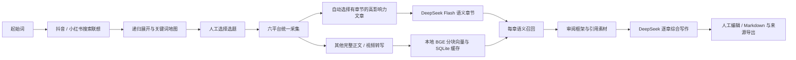

# 从发现选题到文章草稿

KnowFlow 在同一个本机工作台中连接以下流程：



## 发现选题

在侧栏选择“发现选题”，输入起始词，选择抖音、小红书或两平台，以及递归层数和查询间隔。起始词为第0层；只扩展目标深度之前的节点，最外层作为结果保留。搜索联想来自真实浏览器输入和页面／页面自身响应，不能把未确认响应算作空结果。

此模块整合自本机 SearchSuggestMap 2.4.1 的 core、browser、jobs、audit 和 mindmap 实现。保留双平台并发、逐词记录、人工验证暂停、原浏览器继续、导出断点及交互地图。本版在 KnowFlow 内提供关键词表、筛选、分页、地图查看及关键词／关联CSV导出。

“导入原工作台记录”仅从固定本机 `127.0.0.1:4178` 读取已保存断点，跳过原工作台正在运行的任务，以原任务ID去重。也可导入 checkpoint.json。导入创建 KnowFlow 独立副本，不接管旧任务或复制浏览器资料。旧工作台关闭后，新模块仍可独立采集。

每个联想词的“用此词采集”只预填检索词，仍由用户确认平台、目标量后开始采集。任务保存 `topicOrigin`，记录选题任务、节点、平台、层级和起始词；修改检索词会清除旧关联。

## 文章创作

1. 选择已采集任务，进入“文章创作”。先筛选正文完整、至少600字符、6段及2个明确章节标题的图文文章，再按跨平台互动指数排序，默认自动选用最高者，不需要人工选择；界面保留更换入口。结构由可见标题和段落规则识别，不冒充大模型质量评审。内容详情也提供“以此文作为创作框架”。
2. 当前素材范围固定为所选任务。只收录 `contentStatus=completed` 的主体；视频使用完整 transcript。排除参考文章、同URL、规范化全文相同记录及完全相同的参考分块。不会从其他任务偷偷补充素材。
3. “拆解框架并召回素材”调用官方 `deepseek-flash`，返回章节意图、检索问题、原文段落编号。所有段落须被章节或带理由的排除项准确覆盖一次。广告、领资料等可明确排除，排除理由保留供审阅。
4. 其他文章按句号／换行附近分块，最多360字符、约50字符重叠，保留原文字符范围和内容哈希。CPU离线计算 BGE CLS 向量并做L2归一化；超模型token上限报错，不静默截断。
5. 每个章节的问题加BGE中文检索提示后计算向量，按余弦相似度召回。默认最低0.45、前5块、每篇最多2块，同文本块去重；相似度是排序依据，不是事实置信度或经过标定的相关概率。
6. 查看章节、原文段落与召回证据后，点击“按此框架撰写草稿”。写作同时提供本节参考原文 `[R数字]` 与其他文章分块 `[C数字]`，分别标明来源；原文仍不参与其他文章的向量召回。模型按章节独立组织论述；程序拒绝缺引用、未知引用、长度截断或空响应，不会用模板冒充真实模型结果。
7. 草稿可编辑并手动保存，未保存修改不会被轮询覆盖，保存后导出 Markdown 或来源JSON。Markdown只列正文实际引用的来源，附标题、平台、原文URL和字符范围；JSON保留全部召回证据。

该流程生成供审阅的综合草稿。结构相似、引用正确不代表事实与著作权已经审核；本版不自动发布，不承诺内容独创性检测。

## 本地模型配置

准备官方 [BAAI/bge-small-zh-v1.5](https://huggingface.co/BAAI/bge-small-zh-v1.5) 完整目录，含 config、tokenizer、model.safetensors。依赖可安装至现有独立Python环境：

```powershell
python -m pip install -r requirements-embeddings.txt --cache-dir E:\Codex\temp\knowflow\pip-cache
```

在忽略提交的 `settings.local.json` 中覆盖：

```json
{
  "embeddingModel": "E:/Codex/work/knowflow/models/bge-small-zh-v1.5",
  "embeddingPython": "E:/Codex/work/knowflow/.venv/Scripts/python.exe",
  "discoveryDataDir": "E:/Codex/outputs/knowflow/discovery",
  "discoveryWorkDir": "E:/Codex/work/knowflow/private/discovery"
}
```

推理仅从本地加载，不下载模型。向量缓存以模型文件指纹和块哈希隔离，保存在当前SQLite的 embedding 表中。任务快照及章节断点存 creation 表。单活动创作步骤独立于采集调度；本地ASR与BGE同时运行会竞争CPU，建议长视频转写结束后再建索引。

在创作页设置 DeepSeek 密钥：Windows DPAPI加密至 `private/deepseek.dpapi`，仅同机同Windows用户可解密。服务只返回是否已配置，密钥不写入 settings、数据库、Git或导出。该保险箱当前仅支持Windows。API固定官方 `https://api.deepseek.com`，先查模型列表确认 `deepseek-flash`，不静默换模型。参考正文、章节要求、召回素材会按创作步骤发送给DeepSeek；素材向量留在本地。

## 断点与失败

框架、召回及每个完成章节逐步入库。暂停会中止当前模型／向量进程，完成结果保留；服务重启把运行中步骤标为暂停，不自动重复付费请求。继续准备复用已完成框架及缓存，继续写作跳过已有章节。源内容以创作时快照为准；采集库新增内容需新建创作。

HTTP 401、402、429、500及网络错误均作为失败展示，保留阶段和官方请求编号（若提供）。模型列表验证成功只代表账户可列出模型，不代表后续生成必然成功。

## 2026-11-07 实机验证边界

- 本地BGE真实加载成功，512维、CPU推理。技术语义小样本：相关文本余弦0.750，无关餐饮文本0.325。
- 当前 `react agent架构` 任务排除参考及重复后47篇素材、1,162块；首次本地向量化和召回约33秒。用人工诊断框架的3个技术问题，各召回5块，最高相似度0.610—0.645，包含知乎、CSDN、小红书、头条来源。
- 原SearchSuggestMap的已存记录导入、关键词选择、导出和桌面／窄屏界面完成验证。新账号／新资料仍可能需要登录或人工验证。
- 官方模型列表列出 `deepseek-flash`；真实创作请求和最小问候请求均返回HTTP500／503 `internal_error`，包括标准和`/v1`兼容路径。因此本次未取得真实自动语义拆解或DeepSeek草稿，不能宣称端到端生成成功。断点、章节引用校验、编辑和导出另以确定性测试验证。用户可在服务恢复后点击继续；不会自动改用另一模型。

### GPT Luna 独立试跑

按用户要求，通过本机已有加密凭据与 OpenAI Responses 接口独立试跑 `gpt-6-luna`，不改动默认 DeepSeek 配置。自动选用同一篇参考文章，在当前任务内召回素材；拆解及5次章节生成均返回原生 `completed` 响应。

此次生成5章、正文3,369字符，召回25块，使用参考原文及4篇其他文章的引用。第一次试跑在第4章缺引用时被拦截，未作为完成稿交付；补齐本节参考原文证据后重跑通过。去除模型重复输出的章节标题，保留原生回复供核验。引用编号正确不等于逐条事实已核实；部分技术细节主要依据参考文章，BGE相似度不足以证明其他分块支持具体论断。

试跑记录标明实际模型；其他模型的记录不能通过默认提供方继续，以免混淆来源。Luna凭据与本机试跑桥接脚本不随仓库提交。
