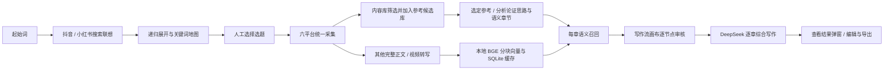

# 从发现选题到文章草稿

KnowFlow 在同一个本机工作台中连接以下流程：



## 发现选题

在侧栏选择“发现选题”，输入起始词，选择抖音、小红书或两平台，以及递归层数和查询间隔。起始词为第0层；只扩展目标深度之前的节点，最外层作为结果保留。搜索联想来自真实浏览器输入和页面／页面自身响应，不能把未确认响应算作空结果。

此模块整合自本机 SearchSuggestMap 2.4.1 的 core、browser、jobs、audit 和 mindmap 实现。保留双平台并发、逐词记录、人工验证暂停、原浏览器继续、导出断点及交互地图。本版在 KnowFlow 内提供关键词表、筛选、分页、地图查看及关键词／关联CSV导出。

“导入原工作台记录”仅从固定本机 `127.0.0.1:4178` 读取已保存断点，跳过原工作台正在运行的任务，以原任务ID去重。也可导入 checkpoint.json。导入创建 KnowFlow 独立副本，不接管旧任务或复制浏览器资料。旧工作台关闭后，新模块仍可独立采集。

每个联想词的“用此词采集”只预填检索词，仍由用户确认平台、目标量后开始采集。任务保存 `topicOrigin`，记录选题任务、节点、平台、层级和起始词；修改检索词会清除旧关联。

## 文章创作

1. 在“内容库”筛选标题、正文、平台和内容类型，阅读全文后点击“加入参考候选”。候选按采集任务持久保存，重复加入不会重复记录；正文未完成的记录不能加入。点击“查看候选库”可预览、选为参考或移除。文章创作不再展示全部内容的参考下拉列表，也不会越过候选库自动选文。已有草稿仍保留原参考快照。
2. 当前素材范围固定为所选任务。只收录 `contentStatus=completed` 的主体；视频使用完整 transcript。排除参考文章、同URL、规范化全文相同记录及完全相同的参考分块，不从其他任务补素材。参考章节原文 `[R数字]` 单独展示，不属于其他文章的召回分块 `[C数字]`。
3. 拆解调用官方 `deepseek-flash`，输出参考文章的论证思路、新文章组织方案、章节意图、章节写作要求、检索问题和原文段落编号。所有段落须由章节或带理由的排除项覆盖一次。历史记录可点击“分析参考文章思路”补充论证路径及要求；分析不覆盖既有正文。
4. 其他文章按句号／换行附近分块，最多360字符、约50字符重叠，保留原文字符范围和内容哈希。CPU离线计算 BGE CLS 向量并做L2归一化；超模型token上限报错，不静默截断。每章问题加中文检索提示后计算向量，默认余弦阈值0.45、前5块、每篇最多2块，同文本块去重。相似度不是事实置信度或相关概率。
5. “写作流画布”取代常驻章节证据列表和全文编辑区。点击章节向外展开检索问题、参考原文、召回分块及章节草稿；侧面审核面板显示完整文本、标题、链接、相似度、字符位置和引用状态。支持缩放、拖动画布、适应视图、全屏、键盘焦点及窄屏布局。节点状态来自真实后端检查点，不模拟生成进度；当前不是逐token流式预览。
6. 每条证据可标记“待审核／保留／排除”并记录理由。每章可修改检索问题、内容要求与补充修改要求。重新召回仅更新本章，保留旧召回出处、已有草稿和仍有效的审核决定；问题改变会提示证据过期。单章重写只向模型发送明确“保留”的证据（参考原文也须明确保留），至少需要一条。首次整体生成使用未排除的证据，未审核材料需人工判断，系统不冒充自动事实审核。
7. 每章写作携带完整目录、所有章节意图与要求、全局组织思路、当前章节要求和已经写出的前文。前文来自当前已编辑的全文，最多携带12,000字符、优先保留较近章节；只用于衔接、去重和术语统一，不作为独立事实证据。引用仍须对应本章提供的原文或召回证据。模型按本章职责综合表达，不拼接或逐句改写来源。
8. 单章重写按全文的 `## 章节标题` 替换本节，保留其他章节的人工编辑，重写前保存完整文章版本（最近20版，可只读预览）。标题被人工修改或重复时拒绝自动替换；失败或暂停保留原稿。审核变化不会自动改写正文，画布会显示“草稿待更新”。记录审核日志及实际模型用量。
9. 点击“查看结果”在弹窗中预览排版后的文章；可切换编辑、保存、导出Markdown或来源JSON。引用标记可跳回对应证据节点。未保存文本不被轮询覆盖。Markdown列实际引用的来源；JSON保留全部召回与审核信息；重新召回后旧正文的引用仍可追溯到先前分块。草稿版本通过专用历史接口读取，不反复塞入每次轮询响应。

该流程生成供审阅的综合草稿。结构相似、引用正确不代表事实与著作权已经审核；本版不自动发布，不承诺内容独创性检测。

## 本地模型配置

准备官方 [BAAI/bge-small-zh-v1.5](https://huggingface.co/BAAI/bge-small-zh-v1.5) 完整目录，含 config、tokenizer、model.safetensors。依赖可安装至现有独立Python环境：

```powershell
python -m pip install -r requirements-embeddings.txt --cache-dir E:\Codex\temp\knowflow\pip-cache
```

在忽略提交的 `settings.local.json` 中覆盖：

```json
{
  "embeddingModel": "E:/Codex/work/knowflow/models/bge-small-zh-v1.5",
  "embeddingPython": "E:/Codex/work/knowflow/.venv/Scripts/python.exe",
  "discoveryDataDir": "E:/Codex/outputs/knowflow/discovery",
  "discoveryWorkDir": "E:/Codex/work/knowflow/private/discovery"
}
```

推理仅从本地加载，不下载模型。向量缓存以模型文件指纹和块哈希隔离，保存在当前SQLite的 embedding 表中。任务快照及章节断点存 creation 表。单活动创作步骤独立于采集调度；本地ASR与BGE同时运行会竞争CPU，建议长视频转写结束后再建索引。

在创作页设置 DeepSeek 密钥：Windows DPAPI加密至 `private/deepseek.dpapi`，仅同机同Windows用户可解密。服务只返回是否已配置，密钥不写入 settings、数据库、Git或导出。该保险箱当前仅支持Windows。API固定官方 `https://api.deepseek.com`，先查模型列表确认 `deepseek-flash`，不静默换模型。参考正文、章节要求、召回素材会按创作步骤发送给DeepSeek；素材向量留在本地。

## 断点与失败

框架、召回及每个完成章节逐步入库。暂停会中止当前模型／向量进程，完成结果保留；服务重启把运行中步骤标为暂停，不自动重复付费请求。继续准备复用已完成框架及缓存，继续写作跳过已有章节。源内容以创作时快照为准；采集库新增内容需新建创作。

HTTP 401、402、429、500及网络错误均作为失败展示，保留阶段和官方请求编号（若提供）。模型列表验证成功只代表账户可列出模型，不代表后续生成必然成功。

## 2026-11-07 实机验证边界

- 本地BGE真实加载成功，512维、CPU推理。技术语义小样本：相关文本余弦0.750，无关餐饮文本0.325。
- 当前 `react agent架构` 任务排除参考及重复后47篇素材、1,162块；首次本地向量化和召回约33秒。用人工诊断框架的3个技术问题，各召回5块，最高相似度0.610—0.645，包含知乎、CSDN、小红书、头条来源。
- 原SearchSuggestMap的已存记录导入、关键词选择、导出和桌面／窄屏界面完成验证。新账号／新资料仍可能需要登录或人工验证。
- 早期官方接口曾返回HTTP500／503，保留失败断点且未替换模型。服务恢复后，已用 `deepseek-flash` 在相同框架与素材上完成5章正文及一次事实表述修订；该次框架来自Luna，不能记为DeepSeek拆解。实际模型分别保存在阶段usage中。

### GPT Luna 独立试跑

按用户要求，通过本机已有加密凭据与 OpenAI Responses 接口独立试跑 `gpt-6-luna`，不改动默认 DeepSeek 配置。自动选用同一篇参考文章，在当前任务内召回素材；拆解及5次章节生成均返回原生 `completed` 响应。

此次生成5章、正文3,369字符，召回25块，使用参考原文及4篇其他文章的引用。第一次试跑在第4章缺引用时被拦截，未作为完成稿交付；补齐本节参考原文证据后重跑通过。去除模型重复输出的章节标题，保留原生回复供核验。引用编号正确不等于逐条事实已核实；部分技术细节主要依据参考文章，BGE相似度不足以证明其他分块支持具体论断。

试跑记录标明实际模型；其他模型的记录不能通过默认提供方继续，以免混淆来源。Luna凭据与本机试跑桥接脚本不随仓库提交。

### 写作流画布验收

2026-11-07 在独立端口、独立SQLite快照中验证新版界面，原服务与生产采集任务未重启。130项本地测试通过；真实浏览器检查候选加入与持久化、选择与全文查看、画布展开、完整证据审核、缩放／全屏、结果弹窗、编辑防轮询覆盖和390px窄屏布局。最终浏览器检查无页面错误或HTTP失败。

真实 `deepseek-flash` 返回参考论证思路和5章内容要求，并使用明确保留的R2、C8重写第2章；其他4章正文保持原样，保存重写前全文。模型曾返回不完整结构或非有效JSON，校验后失败且原稿保留；后续有效响应才计成功。另以本地BGE真实执行第4章改问题后召回，返回5块，原稿不变，旧引用仍可导出追溯。这些结果证明流程与审核控制可操作，不证明召回块均相关，也不等于全文事实、连贯性或原创性已经自动审核通过。
