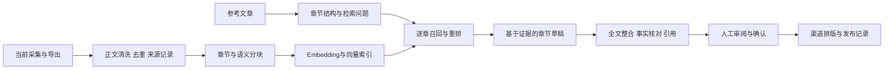

# KnowFlow 后续规划

当前源码实现内容采集、正文／视频转写、互动评分与导出。以下均为待开发能力，不是本次上传版本已经具备的功能。

## 目标工作流

用户选择一篇参考文章，按章节形成检索问题，在自有知识库召回每章语义相似的内容分块，结合证据生成新的文章草稿，审核后适配自媒体渠道发布。

## 规划阶段

| 阶段 | 要实现的能力 | 验收重点 |
| --- | --- | --- |
| 知识入库 | 正文版本、去重、章节识别、分块、Embedding与向量索引 | 每个分块能追溯原文、章节、平台、采集时间 |
| 章节召回 | 按参考文章的每个章节生成语义查询，支持平台、日期、来源筛选与重排 | 能展示相似分块、分数、原文链接；资料不足时明示 |
| 辅助创作 | 结合召回证据进行自主表达、章节衔接、引用和事实核对 | 草稿与来源分离，保留引用关系和生成版本，避免简单拼贴原文 |
| 发布管理 | 不同平台的标题、正文、配图、排版和发布状态 | 人工审核后发布，保存实际发布链接和失败记录 |

Embedding模型、向量数据库、重排模型、生成模型与发布接入方式尚待选型。检索相似度、采集互动影响力与草稿质量应作为不同指标，不混成同一个分数。

本机浏览器Cookie、私有文章库、向量数据及模型凭据不应随源码提交。涉及模型服务或发布接口的本机设置放在Git忽略的配置中。
